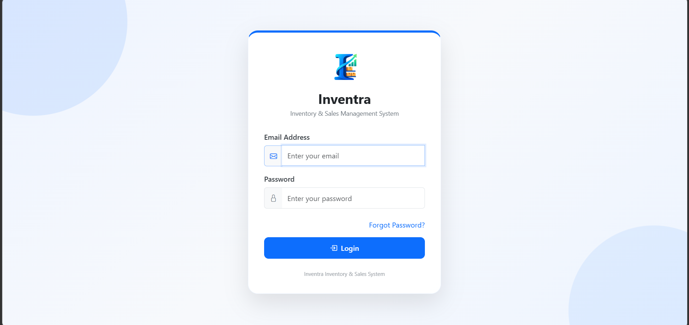
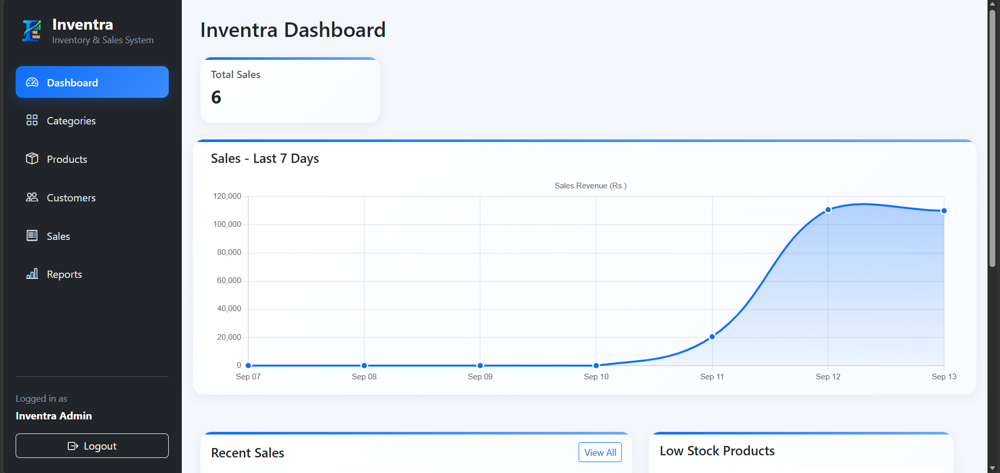
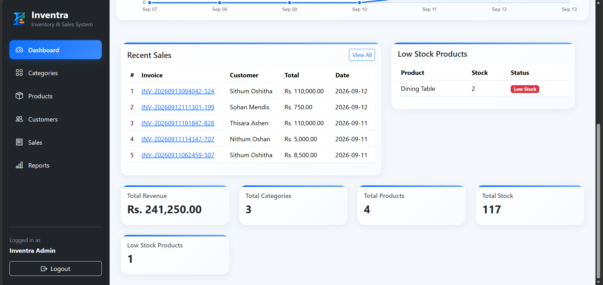
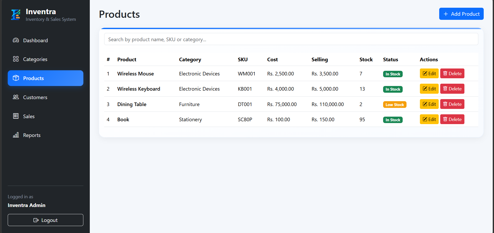
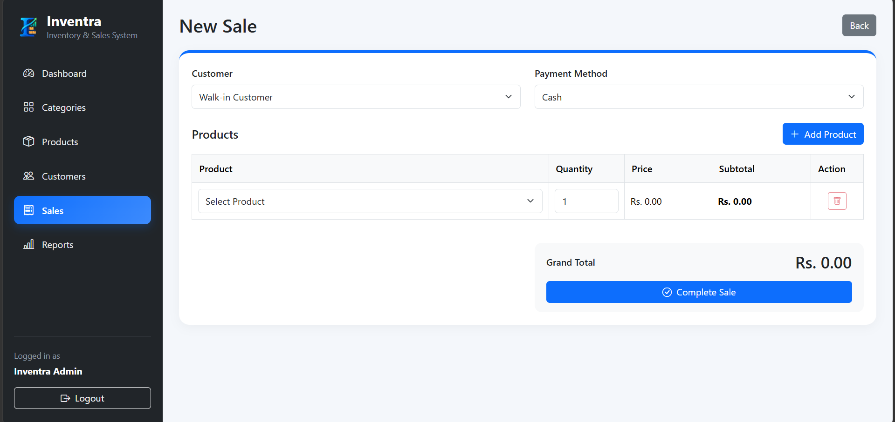
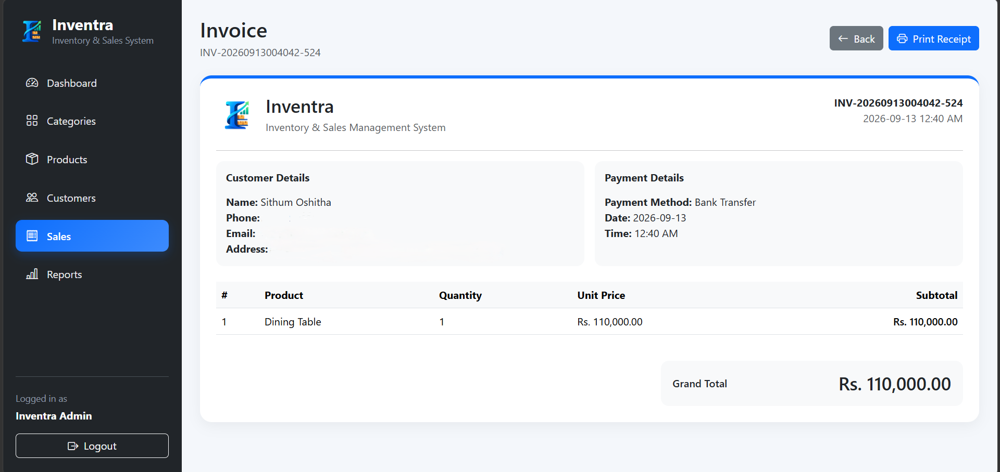
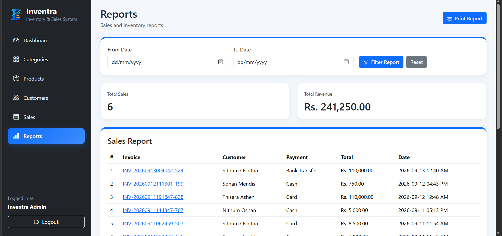
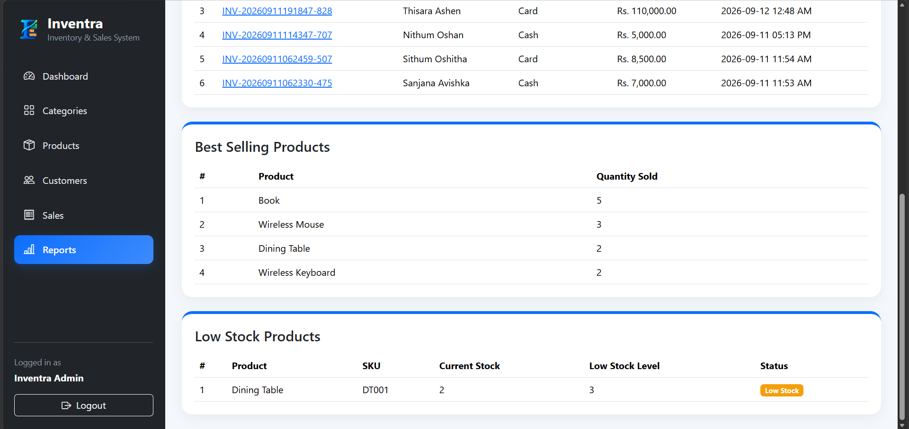

# Inventra

Inventra is a modern Inventory and Sales Management System built with Laravel and MySQL.

The system is designed for small and medium-sized businesses to manage products, categories, customers, sales, stock levels, invoices, and reports through a clean and user-friendly dashboard.

---

## Features

### Authentication
- Secure admin login
- Logout functionality
- Forgot password
- Password reset using secure reset tokens
- Protected application routes

### Dashboard
- Total categories
- Total products
- Total stock
- Low stock products
- Total sales
- Total revenue
- Recent sales
- Low stock overview
- 7-day sales revenue chart
- Animated statistics

### Categories
- Add categories
- Edit categories
- Delete categories
- Live search and suggestions

### Products
- Add products
- Edit products
- Delete products
- Product categories
- Unique SKU support
- Cost price
- Selling price
- Stock quantity
- Low stock level
- Live product search
- In Stock / Low Stock / Out of Stock status

### Customers
- Add customers
- Edit customer details
- Delete customers
- Customer contact information
- Live search by name, phone, or email

### Sales
- Create multi-product sales
- Walk-in customer support
- Registered customer selection
- Cash payments
- Card payments
- Bank transfers
- Automatic subtotal calculation
- Automatic grand total calculation
- Automatic stock reduction
- Stock restoration when a sale is deleted
- Insufficient stock validation
- Low stock alerts
- Out of stock alerts
- Sound notifications for stock warnings

### Invoices
- Invoice generation
- Customer details
- Product details
- Payment information
- Sri Lanka date and time support
- 80mm thermal receipt printing

### Reports
- Sales reports
- Date range filtering
- Total sales
- Total revenue
- Best-selling products
- Low stock products
- Out of stock products
- A4 printable business report

### User Interface
- Responsive Bootstrap interface
- Animated page transitions
- Smooth card and button effects
- Sidebar navigation
- Active navigation indicators
- Animated confirmation dialogs
- Success, update, delete, and stock notifications
- Animated login page

---

## Tech Stack

- Laravel 13
- PHP 8.3
- MySQL
- Blade Templates
- Bootstrap 5
- Bootstrap Icons
- JavaScript
- Chart.js
- HTML5
- CSS3

---

## Requirements

Before running Inventra, make sure the following software is installed:

- PHP 8.2 or higher
- Composer
- MySQL
- Laravel compatible local server such as Laragon, XAMPP, or similar

---

---

---

## Screenshots

### Login


### Dashboard


### Dashboard Details


### Products


### New Sale


### Invoice


### Reports Overview


### Reports Details


## Installation

Clone the repository:

```bash
git clone https://github.com/oshadhagunawardhana/inventra.git
## WSO2 Identity Server login

This integration adds optional WSO2 sign-in to Inventra using OpenID Connect authorization code flow with S256 PKCE. Enable it only after configuring your Identity Server. Existing local login continues to work. New WSO2 users are not automatically granted inventory access; an administrator links each identity to an existing Inventra account using its exact issuer and subject.

### Install the changes in Laragon

Back up your project and database before applying the update. This update is based on the current GitHub repository; compare changes first if your local files are newer.

1. Copy the update files into `C:\laragon\www\smart-inventory-system`. The ZIP contains only changed files, not a complete application.
2. Open Laragon Terminal in that folder and run:

```powershell
composer install
php artisan migrate
php artisan config:clear
```

Do not replace your existing `.env`. Add the WSO2 variables from `.env.example` to it.

### Register Inventra in WSO2

Use a development installation of [WSO2 Identity Server](https://is.docs.wso2.com/en/latest/get-started/quick-start-guide/). Follow its installation prerequisites for the version you choose.

Register a confidential web application using OpenID Connect:

- Application name: `Inventra`
- Grant: authorization code
- PKCE: mandatory; S256
- Callback URL: `http://localhost:8000/auth/wso2/callback`
- Token endpoint authentication: `client_secret_basic`
- ID token signing algorithm: `RS256`
- Scopes: `openid profile email`
- Response mode: query

If you use a Laragon `.test` hostname instead, change both the registered callback and `WSO2_REDIRECT_URI` to that same exact URL.

Obtain the discovery document from your server. Set `WSO2_ISSUER` to its exact `issuer` value. `WSO2_PROVIDER_URL` is the discovery URL with `/.well-known/openid-configuration` removed. Some WSO2 configurations expose discovery directly at `/oauth2/oidcdiscovery`; in that case, use the documented well-known endpoint or configure a well-known endpoint on the server. The client appends `/.well-known/openid-configuration` to the provider URL.

Example only — verify these URLs against your actual server:

```dotenv
WSO2_ENABLED=true
WSO2_ISSUER=https://localhost:9443/oauth2/token
WSO2_PROVIDER_URL=https://localhost:9443/oauth2/oidcdiscovery
WSO2_CLIENT_ID=your-application-client-id
WSO2_CLIENT_SECRET=your-application-client-secret
WSO2_REDIRECT_URI=http://localhost:8000/auth/wso2/callback
WSO2_CA_BUNDLE=C:/path/to/trusted-wso2-ca-bundle.pem
```

For a development certificate, use a trusted PEM CA bundle and a certificate valid for the server hostname. TLS certificate verification stays enabled. Keep secrets, keys, access tokens and real customer data out of GitHub, screenshots and published posts.

### Grant access and test

Create a development user in WSO2. Determine that user's exact OIDC `sub` using the Identity Server subject configuration and your test user's identity. Do not assume it is their email address. Link it to an existing Inventra account:

```powershell
php artisan wso2:link-user "your-inventra-email@example.com" "exact-wso2-subject"
php artisan config:clear
php artisan serve
```

Open `http://localhost:8000/login`, select **Sign in with WSO2**, and authenticate as the linked test user. Confirm the dashboard opens. Try an unlinked WSO2 user and confirm access is denied. Test cancelled login, expired login and normal local login. Inventra logout ends the Inventra session; the WSO2 browser session remains active, so signing in again can reuse it.

### Verification and contribution evidence

```powershell
php artisan test --compact tests/Feature/Wso2LoginTest.php
```

The 10 automated tests use simulated provider endpoints with RSA-signed tokens. They cover PKCE, successful linked login, token signature and claim validation, invalid/expired callback state, replay after logout, denied access for unlinked identities, configuration and identity linking. They do **not** prove that a live WSO2 installation is configured correctly. On PHP 8.4/8.5, the OIDC dependency currently emits nullable parameter deprecation notices; tests still pass.

For internship evidence, complete the live login test, publish the code, add redacted screenshots of app configuration/login/dashboard and record the server version and steps you personally performed. Then write an original blog post describing what you learned. Points are not complete merely because this code has been prepared.

The existing `league/commonmark` 2.10.1 dependency has two Composer advisories. Review `composer audit` and update it to a fixed compatible release before production use.

References: [WSO2 PKCE flow](https://is.docs.wso2.com/en/latest/guides/authentication/oidc/implement-auth-code-with-pkce/), [OIDC app settings](https://is.docs.wso2.com/en/latest/references/app-settings/oidc-settings-for-app/), [internship contribution requirements](https://wso2.com/careers/internships/engineering-intern/).
